# csp-dash-sim

**A browser simulator for Assetto Corsa steering wheel displays.** Write a dashboard in Lua for Custom Shaders Patch (CSP), and watch it run in your browser with live car data, on any OS and without starting Assetto Corsa.

Built around the **VRC Formula Alpha 2025** (CSP version). Two example dashboards are included.

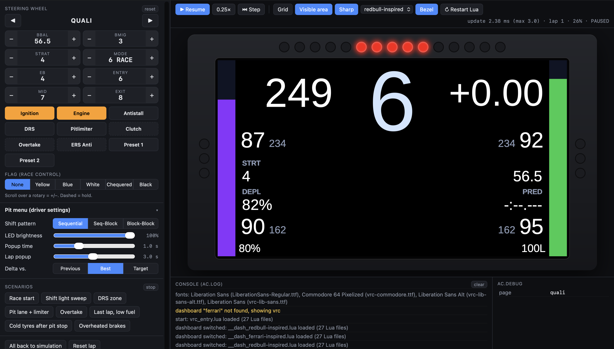

<!-- Demo video: open this README on github.com, click the pencil (Edit), drag your .mp4 (max 10 MB) here and commit. GitHub replaces it with a video player link. -->

> [!NOTE]
> **This is a hobby project and a work in progress.** I built it to have a fast way to try out Lua dashboards without restarting the game for every change. It works well for that, but it is not perfect: the simulation is an approximation of the real car, not every CSP API is emulated, and the dashboards **have not been tested in-game yet**. Bug reports and ideas are welcome in [Issues](https://github.com/NilasMeeder/csp-dash-sim/issues).

> [!IMPORTANT]
> **Unofficial fan project.** It is not affiliated with or endorsed by Virtual Racing Cars (VRC), Kunos Simulazioni, Custom Shaders Patch, Formula 1, or any F1 team. This repository contains **no VRC files**. To use the dashboards in-game (or to show VRC's original dashboard in the preview) you need your own copy of the car. Team names are only used to describe what a dashboard was inspired by.

## Contents

- [Why](#why)
- [Getting started](#getting-started)
- [What you can do in the preview](#what-you-can-do-in-the-preview)
- [Included dashboards](#included-dashboards)
- [Making your own dashboard](#making-your-own-dashboard)
- [Installing in Assetto Corsa](#installing-in-assetto-corsa)
- [Known limitations](#known-limitations)
- [Project layout](#project-layout)
- [License](#license)

## Why

Developing a CSP scriptable display normally means: edit the Lua file, start Assetto Corsa, load a session, drive until the situation you want to see happens, notice a typo, repeat. csp-dash-sim shortens that loop to *save the file and look*.

The dashboard script runs **unchanged** in the preview and in AC. The preview emulates the CSP `ui.*`, `display.*` and `ac.*` API on a canvas at the display's real resolution (1024×1024), using [Fengari](https://github.com/fengari-lua/fengari-web) (Lua in JavaScript). A simulated car drives laps and feeds the script with data, and a control panel lets you set any value by hand.

## Getting started

**Requirements:** [Node.js](https://nodejs.org) 18 or newer and a modern browser (Chrome, Edge, Firefox, Safari). Nothing else: no `npm install`, no build step.

### 1. Download

With git:

```sh
git clone https://github.com/NilasMeeder/csp-dash-sim.git
cd csp-dash-sim
```

Or without git: click **Code → Download ZIP** at the top of this page, unzip it, and open a terminal in the unzipped folder.

### 2. Start the preview

```sh
node preview/serve.js
```

### 3. Open it

Go to <http://localhost:5173> and pick a dashboard in the dropdown in the toolbar. Press `space` to start or pause the simulation.

Use another port with `--port 8080`. Stop the server with `Ctrl+C`.

### Optional: VRC's original dashboard and info LEDs

If you own the car, point the preview at your installed copy. The dropdown then also lists VRC's original dashboard, and VRC's info LEDs run next to your own dashboard. Files are read live from that folder; nothing is copied into the repo.

```sh
node preview/serve.js --vrc "C:/Program Files (x86)/Steam/steamapps/common/assettocorsa/content/cars/vrc_formula_alpha_2025_csp"
```

## What you can do in the preview

### Drive a simulated lap

A ~4.5 km fictional track with braking and acceleration zones, 8 gears with upshifts near the limiter, ERS deploy and harvest, DRS zones, lap times and delta, fuel use, and tyre and brake temperatures. Pause, run in slow motion (0.25×), or step one frame at a time.

### Use the steering wheel

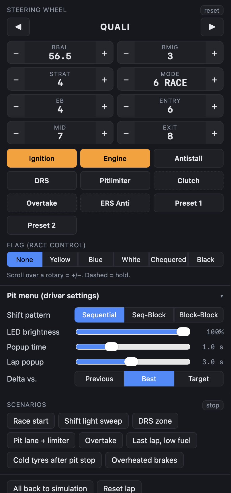

The left panel works like the real wheel:

- **Rotaries:** BBAL, BMIG, STRAT, MODE, EB and diff entry/mid/exit. Click `−`/`+` or scroll over them.
- **Buttons:** ignition, engine start, antistall, DRS, pit limiter, clutch, overtake, ERS, presets. Dashed buttons are *hold* buttons.
- **Pages:** `◀`/`▶` (or the arrow keys) switch between dashboard pages, such as race and quali.
- **Race control flags:** yellow, blue, white, chequered, black.
- **Pit menu:** shift pattern, LED brightness, popup duration, lap popup duration, and what the delta compares against (previous lap, best lap or a target).

<br clear="right">

Turning a rotary shows the popup on the dashboard, just like in the car:

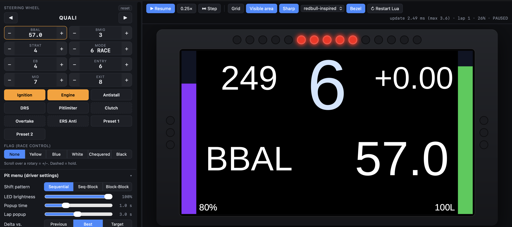

### Play a scenario

One click sets up a situation that is hard to reach on demand in-game: **race start**, **shift light sweep**, **DRS zone**, **pit lane + limiter**, **overtake**, **last lap with low fuel**, **cold tyres after a pit stop** and **overheated brakes**. *All back to simulation* and *Reset lap* return to normal driving.

### Set any value by hand

Under **All data (advanced)** you find every `car` and `sim` field the dashboard can read, grouped by topic, plus the VRC CAN-bus values. Each field has a **SIM** toggle: switch it to manual and drag the slider to test exactly the value you want, for example an almost empty battery or a 0.000 delta.

| All data, grouped | Manual override per field |
|---|---|
| 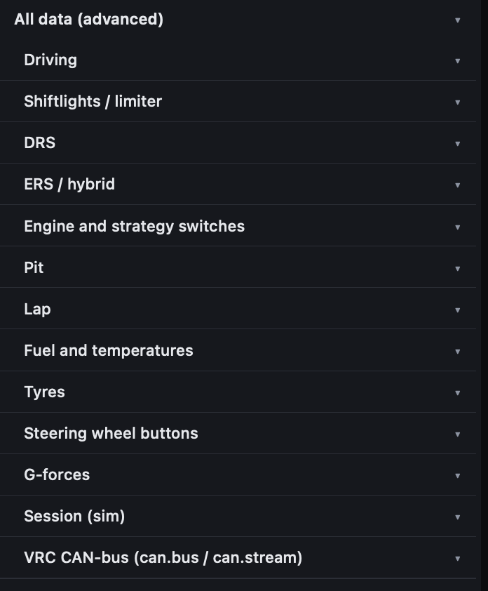 | 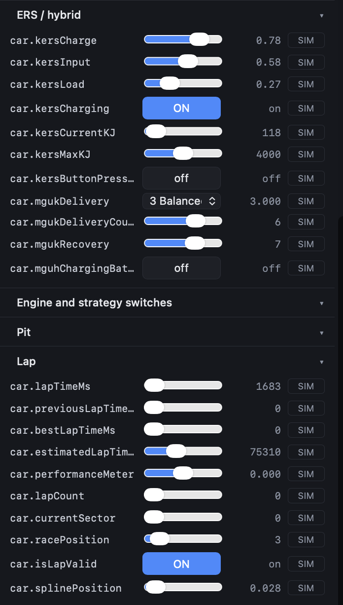 |

### Shift lights

The 15 LEDs above the screen are driven by the dashboard script, including the launch, pit limiter, antistall and engine start sequences.

### Developer tools

- **Hot reload:** save a Lua file and the dashboard restarts right away. The simulation keeps running, so you stay in the same situation.
- **Errors on screen:** Lua errors are shown over the canvas with file, line and traceback.
- **Console:** output from `ac.log` and `ac.debug` appears below the screen.
- **Grid:** a pixel grid with mouse coordinates, for placing elements precisely.
- **Frame time:** the time `update()` takes, shown in the toolbar.
- **Display options:** show only the visible part of the texture, toggle *Sharp* off to see the real 1024 px resolution as in AC, and hide or show the bezel.

**Keyboard:** `space` pause/resume · `.` step one frame · `g` grid · `r` restart Lua · `←` / `→` previous/next page

## Included dashboards

Both were recreated from onboard footage. Switch pages with `◀`/`▶` in the steering wheel panel or the arrow keys. Everything you'd want to tweak (layout, colors, shift light thresholds, texts) is in each dashboard's `settings.lua`.

### Red Bull-inspired

Minimal, with large numbers: speed, gear and delta on top, tyre temperatures in the corners with the brake temperature next to them, and side bars for battery (purple) and fuel (green). Block-style shift lights: red, then blue.

| Race | Quali | Home | Setup |
|:---:|:---:|:---:|:---:|
| 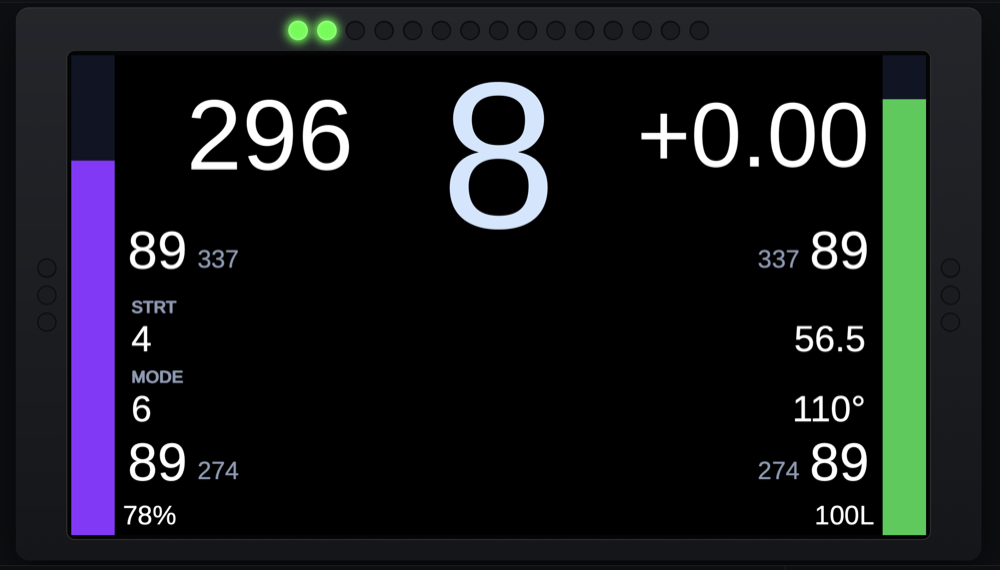 | 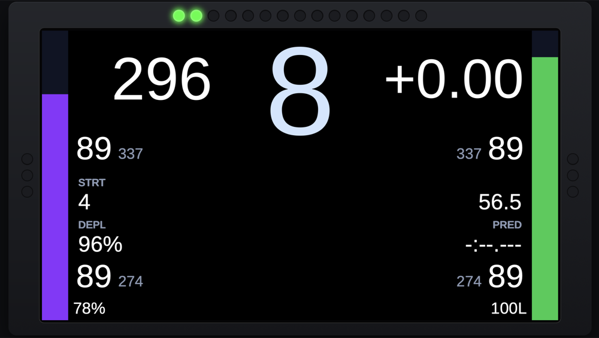 | 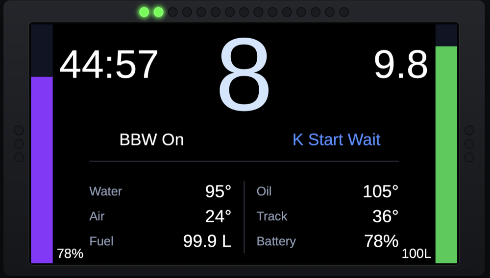 | 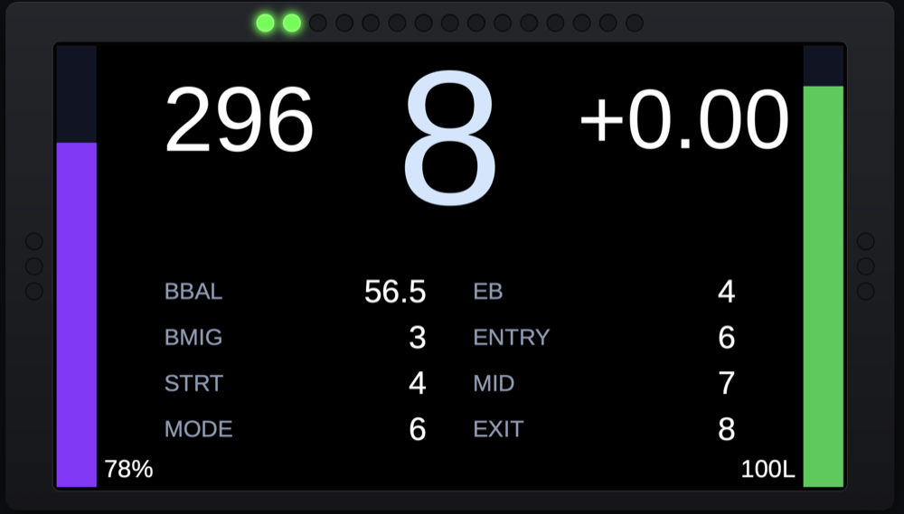 |
| Speed, gear, delta, tyres and brakes, strategy and mode, brake balance, engine temperature | Like race, plus deployment this lap and a predicted lap time | Shown when the ignition is on: clock, rpm, start readiness, temperatures, fuel and battery | All steering wheel settings at a glance |

### Ferrari-inspired

A grid layout with more data: lap time, lap number and delta on top, tyre blocks that change color with temperature, the cars ahead and behind with their gaps, a fuel bar on the left and an ERS bar along the bottom. On a launch, the background fades from green to red to blue with the rpm.

| Race | Quali |
|:---:|:---:|
| 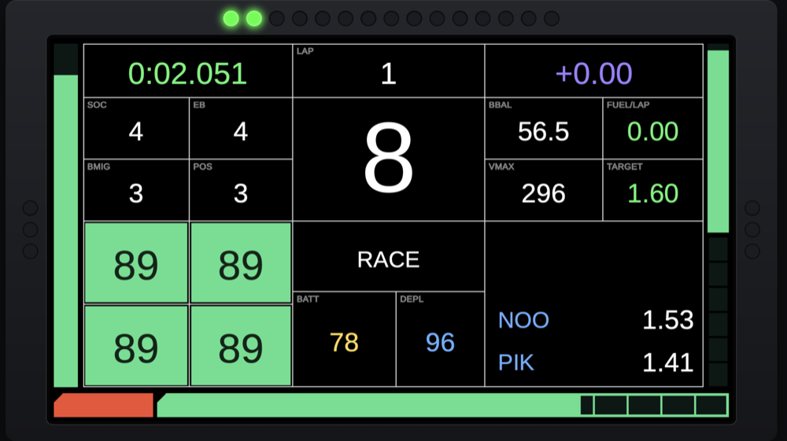 | 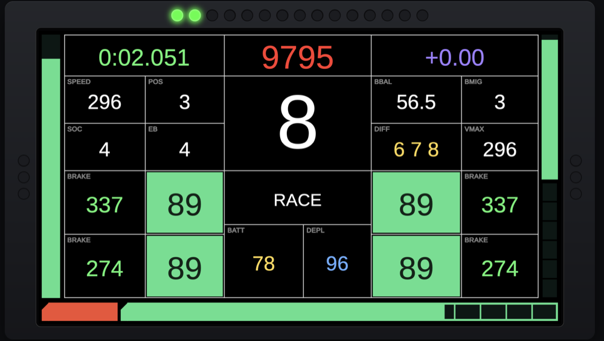 |
| Lap time, delta, tyres, battery and deployment, fuel per lap vs. target, rivals ahead and behind | RPM on top, speed and position, diff settings, tyre and brake temperatures |

## Making your own dashboard

1. Copy `dash/styles/redbull-inspired/` to `dash/styles/<your-name>/`.
2. In the new `dashboard.lua`, change the line `require('dash.styles.redbull-inspired.settings')` to `require('dash.styles.<your-name>.settings')`.
3. Refresh the browser: your dashboard is in the dropdown. From now on, every save reloads it.

A dashboard is a Lua module:

```lua
return {
  update = function(dt) ... end,  -- draws one frame
  ledModule = ...,                -- drives the shift lights
}
```

Shared helpers live in `dash/core/`:

| Module | What it does |
|---|---|
| `data.lua` | All car data in one place |
| `leds.lua` | Shift lights and LED sequences |
| `popups.lua` | Rotary and button popups |
| `lappopup.lua` | Lap time popup |
| `pages.lua` | Page switching |
| `draw.lua`, `format.lua` | Drawing and number/time formatting helpers |

Only use APIs that exist in CSP (see the SDK in `sdk/`), so the same script also works in AC. If the preview accepts something AC does not, that is a bug in the preview: please report it.

## Installing in Assetto Corsa

> [!WARNING]
> Not tested in-game yet. Back up your car folder first.

```sh
node tools/build.js --car "<path to>/content/cars/vrc_formula_alpha_2025_csp" --dash redbull-inspired
```

This creates a `dist/` folder with all dashboards plus patched copies of two of the car's own scripts (`display.lua` and `lights.lua`, made from **your** copy of the car). Then follow `dist/INSTALL.txt`. If the custom dashboard fails to load, the screen falls back to VRC's own dashboard.

> `dist/` contains VRC code from your own copy of the car. Do not share or upload it (it is in `.gitignore`).

## Known limitations

- **No in-game testing yet.** Everything so far has been checked in the preview only.
- **Partial CSP emulation.** The shim covers what scriptable displays commonly use. Less common functions may be missing or behave slightly differently than in AC.
- **Approximate physics.** The simulated lap is meant to produce realistic-looking data, not to match the real car's behavior.
- **VRC Formula Alpha 2025 only.** The display size, LED layout and CAN-bus fields are set up for this car. Other cars would need changes.
- **Font rendering** in the browser can differ slightly from AC.

## Project layout

```
dash/            dashboards (in AC this becomes data_override/dash/)
  core/          shared modules
  styles/<name>/ dashboard.lua + settings.lua per dashboard
  fonts/         Liberation Sans (SIL OFL)
preview/         the browser simulator (server, CSP API shim, renderer, simulation, UI)
tools/           build.js (dist/ for AC), check-preview.js (headless Chrome check + screenshots)
sdk/             CSP Lua SDK definitions, used as API reference and for the field list
docs/            screenshots for this README
```

## License

The code in this repository is MIT licensed (see [LICENSE](LICENSE)). Third-party components and their licenses are listed in [THIRD_PARTY.md](THIRD_PARTY.md).
