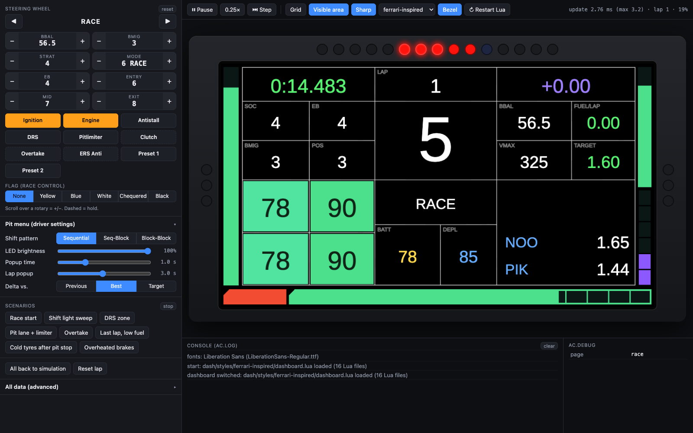
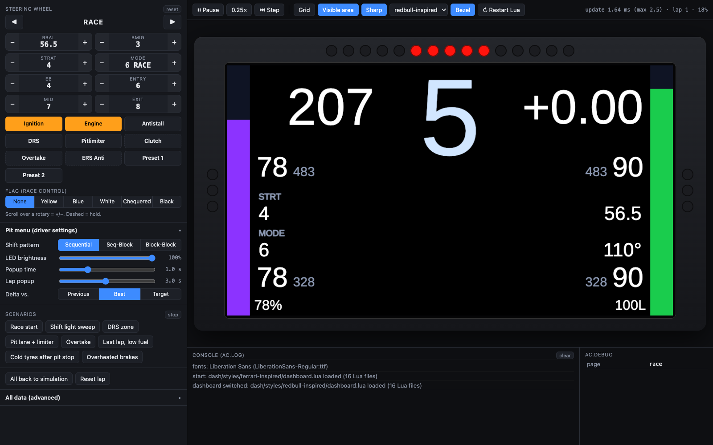

# csp-dash-sim

A browser simulator for **Assetto Corsa steering wheel displays** written in Lua for Custom Shaders Patch (CSP), built for the **VRC Formula Alpha 2025**.

You write the dashboard as a CSP scriptable display script. The preview runs that same script in your browser, on any OS and without Assetto Corsa. A simulated lap and a control panel feed it with car data. Two example dashboards are included.

> [!WARNING]
> **Not tested in-game yet.** So far the dashboards have only been built and checked in this browser preview. They are made for the VRC Formula Alpha 2025 (CSP version), but they have not been confirmed to work in Assetto Corsa.

> [!NOTE]
> **Unofficial fan project.** It is not affiliated with or endorsed by Virtual Racing Cars (VRC), Kunos Simulazioni, Custom Shaders Patch, Formula 1, or any F1 team. This repository contains **no VRC files**. To use the dashboards in-game (or to show VRC's original dashboard in the preview) you need your own copy of the car. Team names are only used to describe what a dashboard was inspired by.



<!-- Demo video: drag an .mp4 (max 10 MB) into this README on github.com; GitHub turns the upload link into a video player. -->

## Features

- **Runs the real script.** The dashboard Lua runs unchanged in the preview and in AC. The preview emulates the CSP `ui.*` / `display.*` / `ac.*` API on a canvas at the display's exact resolution (1024×1024), using Fengari (Lua in JavaScript).
- **Simulated lap.** A ~4.5 km fictional track with braking and acceleration, 8 gears, upshifts near the limiter, ERS deploy and harvest, DRS zones, lap times and delta, fuel use, and tyre and brake temperatures.
- **Steering wheel controls.** Rotaries (BBAL, BMIG, STRAT, MODE, EB, diff entry/mid/exit), ignition and engine, antistall, DRS, pit limiter, clutch, overtake, and flags.
- **Every field by hand.** Each `car` / `sim` field can be switched from *simulation* to *manual* with its own slider.
- **One-click scenarios.** Race start, shift light sweep, DRS zone, pit lane + limiter, overtake, last lap with low fuel, cold tyres, overheated brakes.
- **Shift lights.** 15 LEDs above the screen, including launch, pit limiter, antistall and engine start sequences.
- **Developer tools.** Hot reload on save (the Lua state restarts, the simulation keeps running), a pixel grid with mouse coordinates, a console for `ac.log` / `ac.debug`, frame time, and errors with file, line and traceback over the canvas.
- **No dependencies.** Plain Node.js, no `npm install`.

## Quick start

Requirements: [Node.js](https://nodejs.org) 18 or newer and a modern browser.

```sh
git clone https://github.com/NilasMeeder/csp-dash-sim.git
cd csp-dash-sim
node preview/serve.js
```

Open <http://localhost:5173> and pick a dashboard in the toolbar.

Keyboard: `space` pause, `.` step one frame, `g` grid, `r` restart Lua, `←` / `→` dashboard page.

### Optional: VRC's original dashboard and info LEDs

If you own the car, point the preview at your installed copy. It then also shows VRC's original dashboard and runs VRC's info LEDs next to your own dashboard. Files are read live and nothing is copied into the repo.

```sh
node preview/serve.js --vrc "C:/Program Files (x86)/Steam/steamapps/common/assettocorsa/content/cars/vrc_formula_alpha_2025_csp"
```

## Included dashboards

| Red Bull-inspired | Ferrari-inspired |
|---|---|
|  |  |
| Minimal: speed, gear, delta, tyre and brake temperatures, battery and fuel side bars. Pages: race, quali, home, setup. | Grid layout: lap time, delta, tyre blocks that change color with temperature, rivals ahead/behind, an ERS bar. Pages: race, quali. |

Both were built from onboard footage. Everything you'd want to tweak (layout, colors, shift light thresholds, texts) is in each dashboard's `settings.lua`.

## Making your own dashboard

1. Copy `dash/styles/redbull-inspired/` to `dash/styles/<your-name>/` and change the `require('dash.styles.<your-name>.settings')` line in `dashboard.lua`.
2. It shows up in the preview's dropdown right away. Edit and save; the preview reloads.

A dashboard is a module: `return { update = function(dt) ... end, ledModule = ... }`. Shared helpers are in `dash/core/`: `data.lua` (all car data in one place), `leds.lua` (shift lights and LED sequences), `popups.lua`, `pages.lua`, `draw.lua` and `format.lua`. Only use APIs that exist in CSP (see `sdk/`), so the same script works in AC.

## Installing in Assetto Corsa (VRC Formula Alpha 2025)

Remember: not tested in-game yet. Back up first.

```sh
node tools/build.js --car "<path to>/content/cars/vrc_formula_alpha_2025_csp" --dash redbull-inspired
```

This creates `dist/` with all dashboards and patched copies of two of the car's own scripts (`display.lua` and `lights.lua`, made from **your** copy of the car). Then follow `dist/INSTALL.txt`. If the custom dashboard fails to load, the screen falls back to VRC's dashboard.

> `dist/` contains VRC code from your own copy of the car. Do not share or upload it (it is in `.gitignore`).

## Project layout

```
dash/            dashboards (in AC this becomes data_override/dash/)
  core/          shared modules
  styles/<name>/ dashboard.lua + settings.lua per dashboard
  fonts/         Liberation Sans (SIL OFL)
preview/         the browser simulator (server, CSP API shim, renderer, simulation, UI)
tools/           build.js (dist/ for AC), check-preview.js (headless Chrome check + screenshots)
sdk/             CSP Lua SDK definitions, used as API reference and for the field list
```

## License

The code in this repository is MIT licensed (see [LICENSE](LICENSE)). Third-party components and their licenses are listed in [THIRD_PARTY.md](THIRD_PARTY.md).
